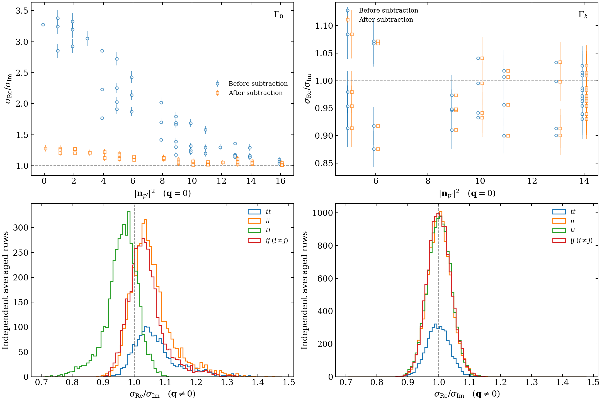

# run001: correlator-error studies

## Real and imaginary errors (2026-11-01)

**Setup.** B64, 725 matched configurations, stout 10, $t_s/a=16$ and
$t_{\mathrm{ins}}/a=8$. Use all 1,685 stored `avgmore` momentum orbits and all
40 projector--EMT channels. Remove exact zeros and proportional symmetry
copies, leaving 55,073 rows; retain noisy channels with zero ground-state
expectation. Source/PT/rotation averaging is inherited from production.

**Method.** Make the EMT traceless and compare
$R=\sigma_{\mathrm{Re}}/\sigma_{\mathrm{Im}}$ of the three-point correlator.
For allowed zero-transfer vacuum terms, form
$C_3^{\mathrm{sub}}=\overline{C_3}-\overline{C_2}\,\overline{L}$ with matched jackknife means.
Use the original `05_moments` statistics utilities, including nested jackknife
propagation for the subtracted error ratios.

Top: zero-transfer diagonal channels, before/after subtraction. Bottom:
nonzero-transfer channels; $i,j$ are spatial indices.

**Findings.**

- At zero transfer, unpolarized diagonal errors change substantially. For
  $\Gamma_0,T^{tt}$ at rest, $R$ changes from $3.278(125)$ to $1.279(48)$;
  at $|\mathbf{n}_{p'}|^2=16$, the subtracted ratio is $1.010(37)$.
  Their remaining difference is $0.269(59)$ using paired jackknife propagation.
- Subtraction changes polarized errors by less than 0.05%. At nonzero transfer,
  polarized sector constants are $R=0.995$--$0.999$, with diagonal
  $\chi^2/\mathrm{dof}=0.99$--$1.04$.
- Nonzero-transfer unpolarized sector constants span $0.954$--$1.062$, with
  $\chi^2/\mathrm{dof}=2.06$--$2.93$: sector separation alone leaves additional
  momentum dependence.

**Working approximation.** Equal real/imaginary errors are useful initially
for nonzero-transfer polarized channels. Unpolarized channels need sector
separation and momentum dependence. The diagonal $\chi^2$ values are descriptive
because rows share configurations; no autocorrelation correction is applied.
